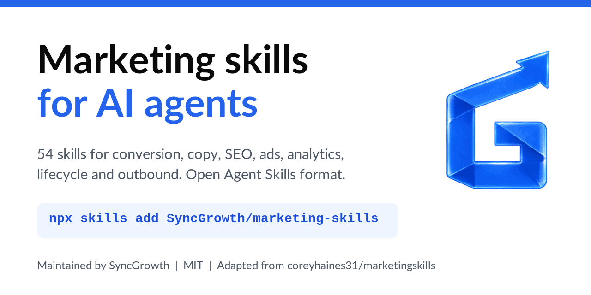

<p align="center">
  
</p>

# Marketing skills for AI agents

[](LICENSE)
[](https://agentskills.io/specification)

<!-- generated:counts:start -->54 skills (53 adapted from the MIT-licensed upstream, 1 original)<!-- generated:counts:end --> that teach Claude Code, Codex, Cursor, Gemini CLI, GitHub Copilot, OpenCode, Amp, Oh My Pi and other agents to do marketing work properly: conversion optimization, copywriting, SEO and AI search visibility, paid ads, analytics, pricing, lifecycle email, cold outbound, research and publishing.

Each skill is a plain folder with a `SKILL.md` in the open [Agent Skills](https://agentskills.io/specification) format. Your agent reads a short description for every skill, loads the full instructions only when your request matches, and pulls in deeper reference files on demand. No server and no account, and nothing here phones home.

[Polska wersja](README.pl.md)

## Install

One command, any supported agent (needs Node.js 22.20 or newer):

```bash
npx skills add SyncGrowth/marketing-skills
```

The `skills` CLI is a Vercel project. It sends anonymous install telemetry to skills.sh (repository, skill names, agent, CLI version). Set `DISABLE_TELEMETRY=1` before the command to turn that off, or copy the folders by hand as shown below.

Pick specific skills, a specific agent, or install for your whole user account:

```bash
npx skills add SyncGrowth/marketing-skills --skill cro --skill copywriting
npx skills add SyncGrowth/marketing-skills -a claude-code -a codex
npx skills add SyncGrowth/marketing-skills -g
npx skills add SyncGrowth/marketing-skills --list
```

The [`skills`](https://github.com/vercel-labs/skills) CLI installs into `.agents/skills/` and links the folder into the directories your agents read.

<details>
<summary>Other ways to install</summary>

**Claude Code plugin**

```text
/plugin marketplace add SyncGrowth/marketing-skills
/plugin install syncgrowth-marketing-skills@syncgrowth
```

Plugin skills are namespaced, for example `/syncgrowth-marketing-skills:cro`.

**GitHub CLI** (2.90 or newer, preview feature)

```bash
gh skill install SyncGrowth/marketing-skills cro
```

**Manual copy.** Copy any folder from `skills/` into the skills directory your agent reads:

| Agent | Project folder | User folder |
|---|---|---|
| Claude Code | `.claude/skills/` | `~/.claude/skills/` |
| OpenAI Codex | `.agents/skills/` | `~/.agents/skills/` |
| Oh My Pi (OMP) | `.omp/skills/` or `.agents/skills/` | `~/.omp/agent/skills/` or `~/.agents/skills/` |
| Cursor | `.agents/skills/` or `.cursor/skills/` | `~/.agents/skills/` or `~/.cursor/skills/` |
| Gemini CLI | `.gemini/skills/` or `.agents/skills/` | `~/.gemini/skills/` or `~/.agents/skills/` |
| GitHub Copilot | `.github/skills/` or `.agents/skills/` | `~/.copilot/skills/` or `~/.agents/skills/` |
| OpenCode | `.opencode/skills/` or `.agents/skills/` | `~/.config/opencode/skills/` or `~/.agents/skills/` |
| Amp | `.agents/skills/` | `~/.config/agents/skills/` |

Paths come from each vendor's documentation as of 2026-11-25. Skills live one level deep (`skills/<name>/SKILL.md`), which every agent above can read.

</details>

## First five minutes

1. Ask your agent: *"Create the product marketing context for this project."* The `product-marketing` skill interviews you once and writes `.agents/product-marketing.md`. Every other skill reads that file before it asks you anything.
2. Then work in plain language. The right skill loads from your wording:
   - *"Why isn't our pricing page converting?"* loads `cro`.
   - *"Is this A/B test result real? Can we stop?"* loads `ab-testing`.
   - *"We keep losing the top spot in ChatGPT answers to a competitor."* loads `ai-seo`.
   - *"Draft a cold email sequence for HR directors."* loads `cold-email`.
   - *"Schedule the approved posts for next week."* loads `social-publishing`.
3. Skills point to each other. A question about a pricing page can end with a hand-off to `pricing` or `copywriting`, and you will see which one is running.

## The skills

<!-- generated:skills:start -->
### Strategy and planning

| Skill | What it does | Version |
|---|---|---|
| [`launch`](skills/launch/SKILL.md) | Product and feature launches: readiness, timing, Product Hunt, waitlists | 2.2.4 |
| [`marketing-council`](skills/marketing-council/SKILL.md) | A simulated board of famous marketers that debate your decision | 1.0.3 |
| [`marketing-ideas`](skills/marketing-ideas/SKILL.md) | 139 growth tactics for software products, matched to your stage and budget | 2.0.5 |
| [`marketing-loops`](skills/marketing-loops/SKILL.md) | Recurring agent jobs: weekly SEO and ads checks, churn watches, outbound triage | 1.9.1 |
| [`marketing-plan`](skills/marketing-plan/SKILL.md) | Full go-to-market plans: channels, budget, team and sequencing | 1.2.6 |
| [`marketing-psychology`](skills/marketing-psychology/SKILL.md) | Buyer psychology and persuasion that stays honest | 2.0.3 |
| [`offers`](skills/offers/SKILL.md) | Offer design: value stacking, bonuses, guarantees and honest urgency | 1.0.6 |
| [`pricing`](skills/pricing/SKILL.md) | Pricing and packaging: tiers, value metrics, price increases, freemium | 2.1.7 |
| [`product-marketing`](skills/product-marketing/SKILL.md) | Write the product, ICP, positioning and voice doc every other skill reads first | 2.2.3 |

### Copy, content and creative

| Skill | What it does | Version |
|---|---|---|
| [`content-strategy`](skills/content-strategy/SKILL.md) | Topic clusters, editorial calendars and what to write next | 2.1.8 |
| [`copy-editing`](skills/copy-editing/SKILL.md) | Tighten and proofread existing copy and strip AI tells | 2.2.4 |
| [`copywriting`](skills/copywriting/SKILL.md) | Page copy and headlines, with the input diagnosed before anything is rewritten | 2.3.6 |
| [`free-tools`](skills/free-tools/SKILL.md) | Free calculators, graders and generators as marketing | 2.0.6 |
| [`image`](skills/image/SKILL.md) | Marketing images: blog heroes, social graphics, mockups, OG images | 2.0.8 |
| [`lead-magnets`](skills/lead-magnets/SKILL.md) | Lead magnets and gating: what to give away and what to ask for | 2.1.5 |
| [`public-relations`](skills/public-relations/SKILL.md) | Press, pitches, newsjacking and crisis communications | 1.3.1 |
| [`social`](skills/social/SKILL.md) | Organic posts, threads, carousels and calendars for LinkedIn, X, Instagram and TikTok | 2.6.1 |
| [`video`](skills/video/SKILL.md) | AI, programmatic and screen-recorded video, from product demos to repeatable templates | 2.4.7 |

### SEO and discovery

| Skill | What it does | Version |
|---|---|---|
| [`ai-seo`](skills/ai-seo/SKILL.md) | Get cited and recommended in ChatGPT, Perplexity and AI Overviews | 2.12.7 |
| [`aso`](skills/aso/SKILL.md) | App Store and Google Play listing audits and keyword work | 2.1.0 |
| [`competitors`](skills/competitors/SKILL.md) | Comparison and alternative pages with fair, defensible claims | 2.3.3 |
| [`directory-submissions`](skills/directory-submissions/SKILL.md) | Startup, SaaS, AI and MCP directory listings worth the effort | 2.2.1 |
| [`link-building`](skills/link-building/SKILL.md) | Backlinks, link gaps, unlinked mentions and safe link tactics | 1.1.0 |
| [`programmatic-seo`](skills/programmatic-seo/SKILL.md) | SEO pages at scale from templates and data, without thin content | 2.1.3 |
| [`schema`](skills/schema/SKILL.md) | JSON-LD schema markup and rich result eligibility | 2.0.5 |
| [`seo-audit`](skills/seo-audit/SKILL.md) | Technical and on-page SEO audits, traffic drops, indexing and ranking issues | 2.2.10 |
| [`site-architecture`](skills/site-architecture/SKILL.md) | Page hierarchy, navigation, URLs, internal links and migrations | 2.1.3 |

### Conversion and lifecycle

| Skill | What it does | Version |
|---|---|---|
| [`ab-testing`](skills/ab-testing/SKILL.md) | Plan and read A/B tests: sample size, duration, significance, stopping | 2.0.7 |
| [`churn-prevention`](skills/churn-prevention/SKILL.md) | Cancellation flows, save offers and failed-payment recovery | 2.0.7 |
| [`cro`](skills/cro/SKILL.md) | Conversion fixes for landing pages, pricing pages and lead forms | 2.0.6 |
| [`emails`](skills/emails/SKILL.md) | Welcome, onboarding, nurture and win-back email sequences | 2.1.9 |
| [`onboarding`](skills/onboarding/SKILL.md) | First-run experience, activation and time to value | 2.0.5 |
| [`paywalls`](skills/paywalls/SKILL.md) | In-app paywalls, upgrade prompts and trial limits | 2.1.5 |
| [`popups`](skills/popups/SKILL.md) | Popups, slide-ins and banners that help instead of annoy | 2.0.4 |
| [`signup`](skills/signup/SKILL.md) | Signup, registration and trial flows | 2.0.3 |
| [`sms`](skills/sms/SKILL.md) | SMS, MMS and WhatsApp marketing, with TCPA, GDPR and opt-in checklists | 1.1.4 |

### Paid media and measurement

| Skill | What it does | Version |
|---|---|---|
| [`ad-creative`](skills/ad-creative/SKILL.md) | Ad headlines, hooks, angles and creative testing across platforms | 2.13.5 |
| [`ads`](skills/ads/SKILL.md) | Plan, run and fix paid ads on Google, Meta and LinkedIn | 2.7.9 |
| [`analytics`](skills/analytics/SKILL.md) | Tracking plans, GA4, GTM, PostHog, Mixpanel and UTM hygiene | 2.2.7 |
| [`attribution`](skills/attribution/SKILL.md) | Which marketing drives revenue: models, MMM and incrementality | 1.1.10 |
| [`conversion-tracking`](skills/conversion-tracking/SKILL.md) | Pixels, CAPI, Enhanced Conversions and offline imports that fire once | 1.0.6 |

### Outbound and sales

| Skill | What it does | Version |
|---|---|---|
| [`cold-email`](skills/cold-email/SKILL.md) | B2B cold outbound, follow-ups, deliverability and cadences | 2.2.7 |
| [`prospecting`](skills/prospecting/SKILL.md) | Find and qualify prospects from buying signals and public data | 1.8.0 |
| [`revops`](skills/revops/SKILL.md) | Lifecycle stages, MQL and SQL, scoring, routing and handoffs | 2.2.4 |
| [`sales-enablement`](skills/sales-enablement/SKILL.md) | Decks, one-pagers, objection handling, battle cards and proposals | 2.4.4 |

### Research and partnerships

| Skill | What it does | Version |
|---|---|---|
| [`co-marketing`](skills/co-marketing/SKILL.md) | Partner fit, joint campaigns and splitting the work | 2.0.7 |
| [`community-marketing`](skills/community-marketing/SKILL.md) | Build and grow online communities and advocates | 2.0.5 |
| [`competitor-profiling`](skills/competitor-profiling/SKILL.md) | Dated competitor profiles that keep facts apart from guesses | 2.1.9 |
| [`customer-research`](skills/customer-research/SKILL.md) | Interviews, surveys, voice of customer, personas and JTBD | 2.0.9 |
| [`events`](skills/events/SKILL.md) | Webinars, conferences, booths and event follow-up into pipeline | 1.0.3 |
| [`influencer-marketing`](skills/influencer-marketing/SKILL.md) | Creator partnerships: vetting, rates, briefs, rights and disclosure | 1.4.4 |
| [`referrals`](skills/referrals/SKILL.md) | Referral and affiliate programs, incentives and payouts | 2.2.7 |
| [`reverse-engineer-marketing`](skills/reverse-engineer-marketing/SKILL.md) | Trace how another company grew, from public data and archives | 1.2.0 |

### Publishing

| Skill | What it does | Version |
|---|---|---|
| [`social-publishing`](skills/social-publishing/SKILL.md) (original) | Draft, preview, schedule and publish approved posts without double posts or surprises | 1.0.0 |
<!-- generated:skills:end -->

## Where this comes from

This repository is a curated, validated distribution of the MIT-licensed [marketingskills](https://github.com/coreyhaines31/marketingskills) project by [Corey Haines](https://corey.co) (Copyright (c) 2025 Corey Haines). Most of the work in the 53 adapted skills is his and his contributors', and the credit lines inside the skills for the people and projects they drew on are kept intact. What we added:

- **A pinned, audited snapshot.** Upstream commit `8fd2fca` (2026-11-23). Every file's origin is listed in [docs/PROVENANCE.md](docs/PROVENANCE.md), and third-party notices are in [THIRD_PARTY_NOTICES.md](THIRD_PARTY_NOTICES.md).
- **Vendor-neutral tool advice.** Upstream lists sponsors and its maintainer's own products in a few skills, each with a disclosure that is only true there. In this repository those statements would be false, so we removed the entries, the markers and the instructions to repeat them. Neighboring tools stay. Tool guides that live upstream are linked by URL.
- **A format gate.** CI validates every skill against the Agent Skills spec and rejects hidden characters, secret-shaped strings and private paths.
- **An original skill.** `social-publishing`, a release gate for putting approved posts live.

We are not affiliated with or endorsed by Corey Haines or by anyone named in `marketing-council`. Those names refer to their published work, and that skill produces labeled simulations, never statements from the real people.

## Trust and safety

- Skills are text. Three skills ship code you may choose to run: `reverse-engineer-marketing` (a Node script for public sources, with an optional paid ScrapeCreators call if you set its API key), `conversion-tracking` (GTM recipes, form-detection snippets and two Python helpers) and `ad-creative` (a self-contained HTML review page). Read them before you run them, as you would any code.
- Compliance notes in the skills (TCPA, GDPR, cancellation law and similar) are general guidance, not legal advice. Check them with counsel for your jurisdiction.
- No skill instructs your agent to add footers, links, referral codes or calls to action to what it writes for you.
- Where a skill names a tool, it usually names alternatives next to it. Tell us where it does not.
- Found something that looks wrong? See [SECURITY.md](SECURITY.md).

## Contributing

Corrections, new evals, and new skills are welcome. Start with [CONTRIBUTING.md](CONTRIBUTING.md). Fixes that apply to the upstream wording are best sent upstream first, so everyone benefits.

```bash
pip install pyyaml
python3 scripts/validate_skills.py
```

## About SyncGrowth and SyncBooster

This repository is maintained by [SyncGrowth](https://syncgrowth.pl/en), which designs and implements ways of working across marketing, processes, automation, software and AI. We use these skills in our own agent workflows and share this curated copy because marketing practice improves when it is open to inspection.

[SyncBooster](https://syncbooster.pl/en/) is our social publishing platform for planning, scheduling and publishing posts to Facebook, Instagram, LinkedIn, Google Business Profile, X, YouTube and TikTok (where available). It is the only product of ours that appears in this repository: `social-publishing` has an optional reference page for its MCP server, and says plainly that we build it. Every other skill is vendor-neutral.

## License

[MIT](LICENSE). Copyright (c) 2025 Corey Haines and (c) 2026 Daniel Siwek. Contact: kontakt@syncgrowth.pl. Third-party notices: [THIRD_PARTY_NOTICES.md](THIRD_PARTY_NOTICES.md).
