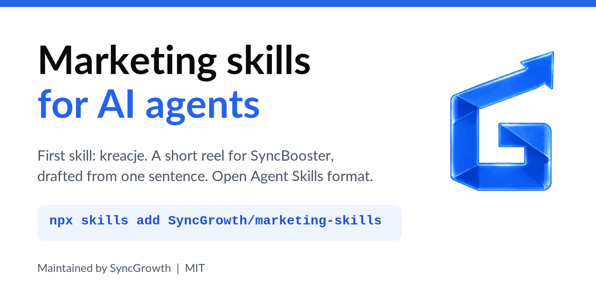

<p align="center">
  
</p>

# Umiejętności marketingowe dla agentów AI

[](LICENSE)

Zbiór umiejętności (skills) marketingowych dla agentów AI w otwartym formacie [Agent Skills](https://agentskills.io/specification). Powstał z myślą o [SyncBoosterze](https://syncbooster.pl) i o każdym innym agencie, który potrafi czytać folder z umiejętnością. Dziś zbiór ma jedną umiejętność, **`kreacje`**: z jednego zdania opisu robi szkic rolki w module Kreacje w SyncBoosterze. Kolejne umiejętności dojdą później, każda z jasnym zadaniem i jasnym właścicielem.

[English README](README.md)

## Umiejętności

<!-- generated:skills:start -->
### Video and creative

| Skill | What it does | Source |
|---|---|---|
| [`kreacje`](skills/kreacje/SKILL.md) | Draft a SyncBooster Kreacje reel from a one-sentence brief; prices and dates stay with the user | Mirror of SyncBooster backend, skills/kreacje, catalog 7 |
<!-- generated:skills:end -->

Tabela jest generowana z `skills.json`, więc opisy są po angielsku. Same umiejętności też są po angielsku, a agent odpowiada w języku, w którym do niego piszesz.

## kreacje: szkic rolki z jednego zdania

Piszesz agentowi krótki opis, na przykład *„Rolka na 20 sekund o wyprzedaży zimowych kurtek, pionowa, po polsku”*. Umiejętność podpowiada agentowi, jak z tego zrobić darmowy szkic w SyncBoosterze, w zakładce Studio > Kreacje:

- Agent ustala cel (promocja, premiera, wydarzenie, opinia klienta, wyjaśnienie albo marka), język, format (domyślnie 9:16) i długość (15 do 30 sekund, jeśli nie napiszesz inaczej, nigdy więcej niż 60).
- Wybiera 3 do 6 scen, które opowiadają jedną historię: zaczepka, oferta albo korzyść, dowód albo szczegóły i na koniec wezwanie do działania z Twoim logo.
- Pisze teksty na ekranie w Twoim języku, w limitach znaków każdego pola, i uzupełnia zdjęcia, kolory i logo z zestawu marki w SyncBoosterze.
- Kończy krótkim podsumowaniem: co pokazuje szkic i co musisz jeszcze potwierdzić albo dostarczyć.

Ceny, stare ceny, rabaty, kody rabatowe, najniższa cena z 30 dni przed obniżką i terminy promocji to wartości regulowane. Umiejętność przepisuje je tylko z Twojego opisu albo profilu marki, wpisuje wyłącznie w pola scen, które SyncBooster oznacza do potwierdzenia, i każdą zostawia Tobie do potwierdzenia przed renderem. Nie wymyśla, nie zaokrągla i nie wylicza takich wartości, nie twierdzi też, że któraś jest zgodna z prawem.

Umiejętność robi tylko szkic. Render, generowanie obrazów, publikacja i każdy inny krok, który kosztuje tokeny AI albo jest publiczny, to osobne kroki, które zatwierdzasz sam.

### Jak jest używana

**W SyncBoosterze.** Moduł Kreacje ma wbudowanego agenta, który pracuje według tej umiejętności. Opisujesz rolkę, a w panelu pojawia się zwykły projekt Kreacji, który sprawdzasz, uzupełniasz i renderujesz. SyncBooster ładuje własną, przypiętą kopię umiejętności razem z każdym wydaniem, więc zmiana w tym repozytorium nie wpływa na działanie Twojego konta, dopóki SyncBooster jej nie wyda.

**W Twoim własnym agencie, przez serwer MCP SyncBoostera.** Zainstaluj umiejętność, podłącz serwer MCP SyncBoostera do agenta i poproś o rolkę. Są dwie drogi, opisane w [`skills/kreacje/references/tools-mcp.md`](skills/kreacje/references/tools-mcp.md):

1. Po stronie serwera: agent wywołuje `syncbooster_create_creative_from_brief`, SyncBooster robi szkic według tej samej umiejętności, a agent czeka, aż szkic będzie gotowy.
2. Krok po kroku: agent idzie za `SKILL.md` i buduje szkic narzędziami `syncbooster_search_creative_presets`, `syncbooster_create_creative`, `syncbooster_edit_creative` i pokrewnymi.

W obu przypadkach agent pyta Cię przed każdym płatnym albo publicznym krokiem (potwierdzenie wartości, render, generowanie obrazu, tworzenie i publikacja posta), a wcześniejsze „tak” dla innej ceny się nie liczy.

## Instalacja

Jedna komenda, dowolny obsługiwany agent (wymaga Node.js 22.20 lub nowszego):

```bash
npx skills add SyncGrowth/marketing-skills --skill kreacje
```

Narzędzie `skills` należy do Vercela i wysyła anonimową telemetrię instalacji do skills.sh. Ustaw `DISABLE_TELEMETRY=1` przed poleceniem, żeby ją wyłączyć, albo skopiuj folder ręcznie.

Wtyczka Claude Code:

```text
/plugin marketplace add SyncGrowth/marketing-skills
/plugin install syncgrowth-marketing-skills@syncgrowth
```

Ręczne kopiowanie (`skills/kreacje`) i tabela folderów dla każdego agenta: [README po angielsku](README.md#install).

## Gdzie umiejętność jest rozwijana

`kreacje` zależy od katalogu scen i kontraktu narzędzi SyncBoostera: wymienia typy scen, pola i narzędzia, które istnieją tylko tam. Dlatego jej źródło leży w kodzie SyncBoostera, gdzie testy sprawdzają ją z katalogiem przy każdej zmianie, a to repozytorium zawiera opublikowaną kopię. Kopia ma w [`skills.json`](skills.json) pieczątkę z commitem źródła i skrótem plików, a CI zatrzymuje zmianę, gdy pliki nie zgadzają się z pieczątką. Błędy w `kreacje` zgłaszaj tutaj jako zgłoszenie (issue); opiekunowie poprawiają źródło i odświeżają kopię. Umiejętności, które nie zależą od SyncBoostera, powstają i są recenzowane bezpośrednio w tym repozytorium. Szczegóły: [docs/PROVENANCE.md](docs/PROVENANCE.md).

## Kolejne umiejętności

Zbiór ma z czasem objąć kilka umiejętności marketingowych, używanych m.in. z SyncBoosterem. Nowa umiejętność potrzebuje konkretnego zadania opisanego słowami użytkownika, opisu, który każe agentowi załadować ją w odpowiednim momencie, i właściciela, który dba o jej poprawność. Jak zgłosić i dodać umiejętność: [CONTRIBUTING.md](CONTRIBUTING.md).

## Historia

Do 2026-11-26 repozytorium zawierało 54 umiejętności: 53 przejęte z projektu [marketingskills](https://github.com/coreyhaines31/marketingskills) Coreya Hainesa na licencji MIT oraz jedną własną, o publikowaniu postów. Nie należą już do zbioru. Każdy wcześniejszy commit nadal ma licencję i noty stron trzecich, które go dotyczyły, a ostatni stan z tymi umiejętnościami to commit `8eb2834`. Dziękujemy Coreyowi Hainesowi i jego współautorom za tę pracę.

## Bezpieczeństwo i wkład

Umiejętność `kreacje` nie zawiera skryptów. Żadna umiejętność w tym zbiorze nie każe agentowi dopisywać do Twoich tekstów stopek, linków, kodów poleceń ani wezwań do działania. Zgłoszenia dotyczące bezpieczeństwa: [SECURITY.md](SECURITY.md). Zasady współpracy: [CONTRIBUTING.md](CONTRIBUTING.md).

## O SyncGrowth i SyncBooster

Repozytorium prowadzi [SyncGrowth](https://syncgrowth.pl), firma, która projektuje i wdraża sposoby pracy w marketingu, procesach, automatyzacji, oprogramowaniu i AI. [SyncBooster](https://syncbooster.pl) to nasza platforma do planowania i publikowania postów w Facebooku, Instagramie, LinkedInie, Profilu Firmy w Google, X, YouTube i TikToku (tam, gdzie jest dostępny) oraz dom modułu rolek Kreacje. Umiejętności w tym zbiorze mogą być zbudowane wokół SyncBoostera, a każda taka mówi o tym wprost.

## Licencja

[MIT](LICENSE). Prawa autorskie (c) 2026 Daniel Siwek. Kontakt: kontakt@syncgrowth.pl.
